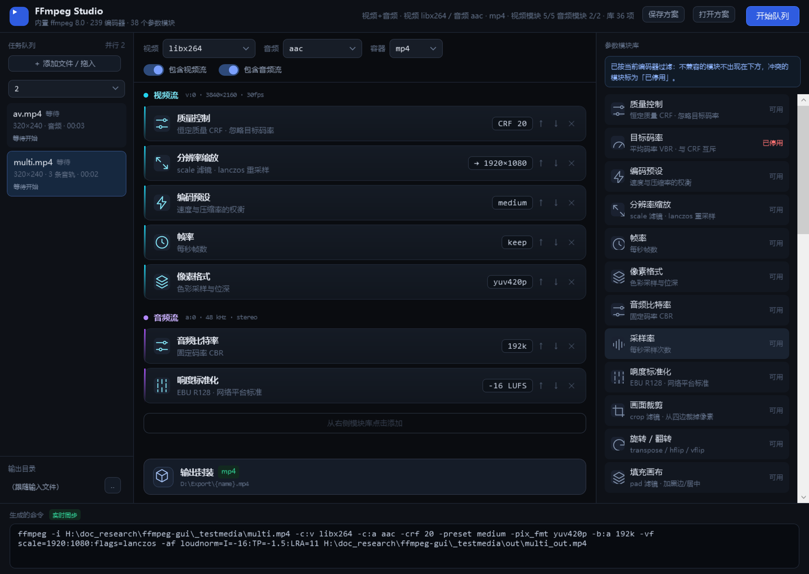
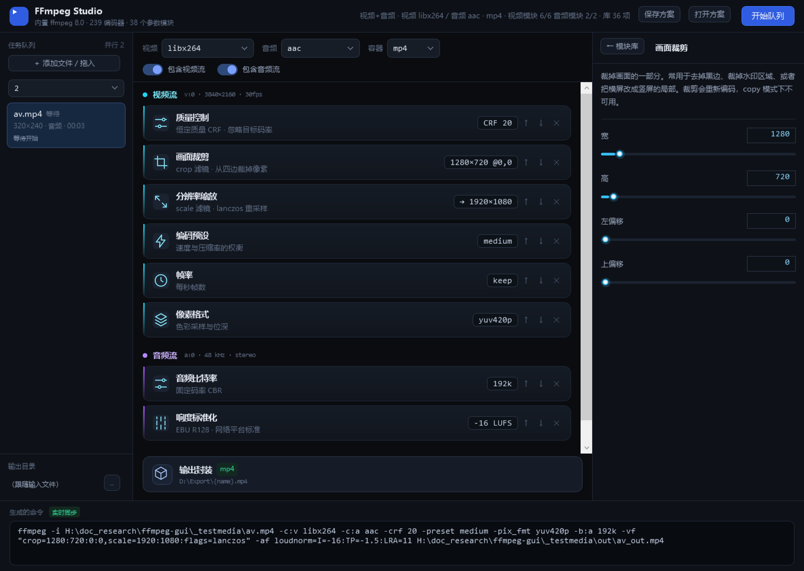
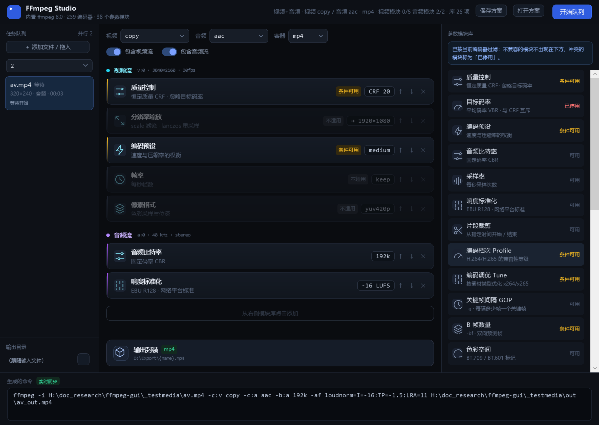
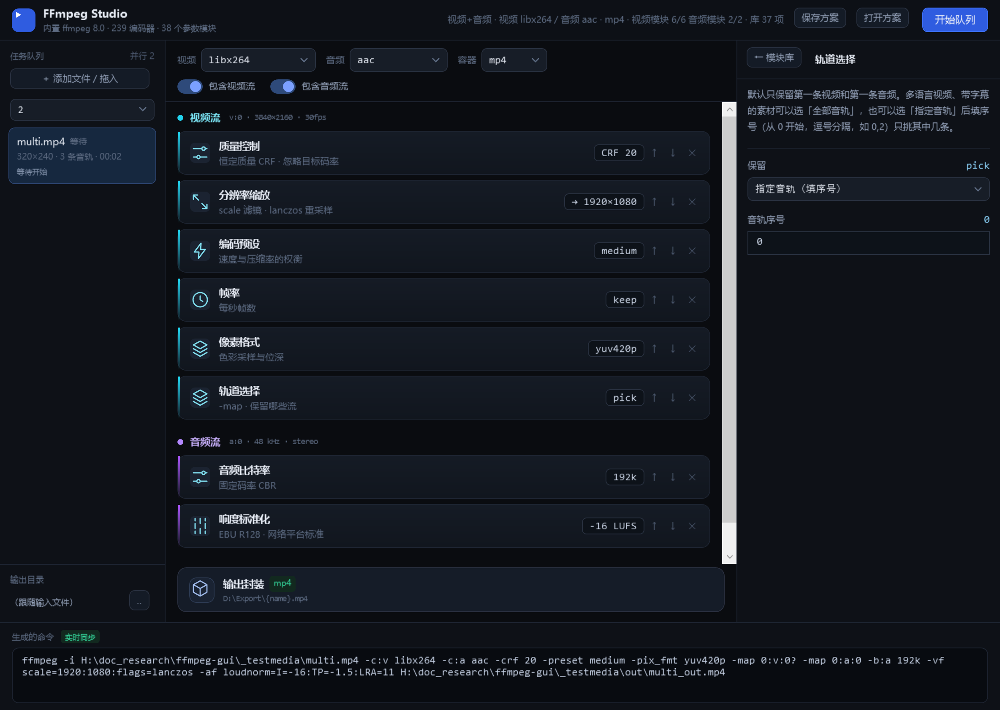

# FFmpeg Studio

线性图形化的 ffmpeg 前端。不写命令行，按「流 + 参数模块链」的方式拼出一条 ffmpeg 命令并执行。

视频转码和**纯音频转换**都能做——输出容器共 12 种，音频侧支持 mp3 / flac / wav / m4a / ogg / opus / aac / wma。

> **v0.1.0 已发布** —— [下载便携包](https://github.com/NaughtDZ/FFmpegStudio/releases/tag/V0.1.0)（Windows x64，解压即用，无需安装 .NET、无需另装 ffmpeg）



---


## 界面

双流参数链是主视图：左边任务队列，中间每条流一条链，右边参数模块库，底部实时命令行。
模块库按**视频参数 / 音频参数 / 输出**分组，和中间两条链是同一套划分。

**参数编辑**（点任意卡片，右侧切成编辑面板）：



**兼容性求值**（把编码器换成流复制 copy，不兼容的模块直接从库里消失，链上标灰）：



**轨道挑选**（多音轨素材可以填序号只保留其中几条）：



## 它解决什么问题

ffmpeg 有 242 个编码器、几千个参数，且参数之间互相牵连：`-crf` 只在 x264/x265 有效，NVENC 要用 `-rc vbr -cq`，copy 模式下所有画质参数全部失效。

这个工具把这套知识做成**可求值的规则**：

- 视频流 / 音频流两条独立的参数链，逐块插入「参数模块」
- 选定编码器后，**不兼容的模块直接不出现**，冲突的模块标灰并写明原因
- 每改一个参数，底部命令行实时更新
- 拖入文件 → ffprobe 探测 → 按实际流类型自动决定输出形态

## 核心设计

### 三层能力数据

| 层 | 内容 | 谁维护 |
|---|---|---|
| **L0 探测** | 242 个编码器、414 个容器、1514 个选项（含类型/范围/默认值） | 全自动，构建期从 `ffmpeg -h encoder=X` 烘焙 |
| **L1 知识** | 中文说明、推荐值、互斥关系、分组 | 手写 JSON |
| **L2 组合** | 模块 = 若干 flag + `bindings`（什么编码器下用什么 flag） | 手写 JSON |

运行时**零探测**：能力表在构建时烤进 `capabilities.json` 并内嵌为资源。ffmpeg 升级时重跑 `tools/dump-capabilities.ps1` 即可。

### 模块 ≠ ffmpeg 选项

同一个 UI 概念在不同编码器上映射到完全不同的 flag：

```json
{
  "id": "quality.crf",
  "title": "质量控制",
  "bindings": [
    { "when": { "encoder": ["libx264","libx265","libsvtav1"] }, "emit": ["-crf", "{crf}"] },
    { "when": { "encoder": ["h264_nvenc"] },                    "emit": ["-rc","vbr","-cq","{crf}"] }
  ]
}
```

加一个新编码器的支持，通常只需要加一行 binding。

### 模块四态

| 状态 | 含义 |
|---|---|
| 可用 | 正常写入命令 |
| 条件可用 | 换个编码器就能用，保留在链上但不产出参数 |
| 已停用 | 与链上已有模块冲突，写明冲突源 |
| 不适用 | 当前组合下无意义，模块库里不列出 |

### 滤镜顺序

普通参数（`-crf` / `-preset` / `-g`…）**顺序完全无关**——实测三个排列输出的文件逐字节相同。

滤镜（`-vf` / `-af`）**顺序决定结果**。所以滤镜模块带一个 `order`（推荐位置），添加时自动插到该在的地方：

```
去交错 10 → 降噪 15 → 旋转 20 → 裁剪 30 → 缩放 40 → 填充 50 → 锐化 60
```

`order` 是模块自身的属性，**与编码器无关**（滤镜在编码之前执行），加新编码器不需要动它。用户随时可以用卡片上的 ↑↓ 推翻。

## 技术栈

- **VB.NET + WPF**，`net10.0-windows`
- 自包含单文件发布 + 内置 ffmpeg，双击即用，无需安装 .NET
- 进度解析用 `-progress pipe:1`（机器可读的 key=value 流），日志走 stderr，两者分离

## 构建

```powershell
# 只编译
pwsh ./build.ps1

# 发布到 dist/（自包含单文件 + 内置 ffmpeg）
pwsh ./build.ps1 -Publish

# 指定 ffmpeg 目录
pwsh ./build.ps1 -Publish -FfmpegDir "C:\ffmpeg\bin"
```

产物：

```
dist\FFmpegStudio.exe    自包含单文件（约 59 MB）
dist\ffmpeg\             内置 ffmpeg / ffprobe 及其 DLL（约 205 MB）
```

## 重新烘焙能力表

内置 ffmpeg 升级后需要重跑，否则能力表和实际行为会对不上：

```powershell
pwsh ./tools/dump-capabilities.ps1 -Ffmpeg "path\to\ffmpeg.exe"
```

产物写入 `src/Data/capabilities.json`（约 0.72 MB）。

## 方案（预设）

当前参数链可以存成 `.json` 方案，下次一键套用。

方案里只存「模块 id + 参数值」，不存模块定义本身——定义永远来自 `modules.json`，
所以以后模块的说明、默认值、binding 更新了，老方案也能跟着受益。

```json
{
  "SchemaVersion": 1,
  "VideoEncoder": "libx264",
  "Container": "mp4",
  "Modules": [
    { "Id": "video.quality.crf", "Values": { "crf": "20" } },
    { "Id": "video.scale", "Values": { "width": "1280", "height": "720" } }
  ]
}
```

## 模块库（38 个）

| 分类 | 模块 |
|---|---|
| 画面 | 裁剪、旋转翻转、填充、锐化、降噪、去交错、色彩调整、去方块 |
| 时间 | 片段裁剪 |
| 画质 | CRF、目标码率、预设、Profile、Tune、GOP、B 帧、色彩空间、两遍编码 |
| 音频 | 比特率、采样率、VBR、声道、音量、淡入、淡出、降噪、压缩、高通、低通、均衡、响度归一、重采样质量 |
| 输出 | 轨道选择、快速启动、元数据 |

## 输出文件名

默认模板 ``{name}_out``，可以改成任意组合：

| 占位 | 含义 | 例子 |
|---|---|---|
| ``{name}`` | 原文件名 | ``av`` |
| ``{date}`` | 日期 | ``20261125`` |
| ``{time}`` | 时间 | ``232229`` |
| ``{index}`` | 队列序号 | ``1`` |
| ``{container}`` | 容器名 | ``mp4`` |

同名文件的处理三选一：**自动改名**（默认，``av_out (2).mp4``）、**覆盖**、**跳过**。
默认不覆盖——转码结果不该因为重名就消失。

## 输出格式

| 视频容器 | 音频容器 |
|---|---|
| mp4 / mkv / mov / webm | m4a / mp3 / flac / wav / ogg / opus / aac / wma |

选音频容器时会自动关掉视频流（mp3 里装不下视频）；拿带视频的素材选 mp3，等于提取音频。
音频编码器会跟着容器收窄：mp3 → libmp3lame、flac → flac、wav → pcm_s16le、ogg → libvorbis/libopus。

无损容器（flac / wav）没有码率概念，「音频比特率」模块会自动变成条件可用，不会往命令里塞 `-b:a`。

## 发版

发版流程和踩过的坑见 [RELEASING.md](RELEASING.md)。

## 目录结构

```
src/
  Core/                 求值器、模块模型、ffmpeg 进程、视图模型
  Data/                 capabilities.json（烘焙产物）+ modules.json（知识层）
  MainWindow.xaml       全部界面
tools/
  dump-capabilities.ps1 构建期能力探测器
docs/                   界面设计稿
build.ps1               构建 / 发布
```

## 调试入口

程序内置几个命令行开关，用于无人值守的回归验证：

| 参数 | 作用 |
|---|---|
| `--shot <png>` | 把界面渲染成 PNG 后退出 |
| `--add "a.mp4;b.mp3"` | 启动即导入文件 |
| `--autorun` | 启动后自动跑完队列再截图 |
| `--eval <enc> <cont>` | 把求值表打到控制台 |
| `--enc <name>` | 预设视频编码器 |
| `--select <moduleId>` | 打开指定模块的编辑面板 |
| `--mode av\|video\|audio` | 预设媒体模式 |
| `--outdir <dir>` | 设置输出目录 |
| `--set <模块id> <键> <值>` | 改参数（可重复） |
| `--save-preset <json>` / `--load-preset <json>` | 方案存取 |
| `--command-out <txt>` | 把生成的命令写到文件 |
| `--add-module <id>` / `--remove <id>` | 增删链上模块（可重复） |
| `--hwcheck <txt>` | 跑一遍硬件编码器探测并输出报告 |
| `--no-hwprobe` | 跳过启动时的硬件探测 |

## 已知未完成

- 模块排序：已有卡片上的 ↑↓ 按钮（不做拖拽），但还不能跨流拖动
- 多音轨：支持自动 / 全部 / 指定序号（如 0,2），但还不能按语言或标题挑选
- 两遍编码只对 libx264/libx265 生效（其他编码器没有 pass 语义）

## 许可

私用项目，暂未选择许可证。
